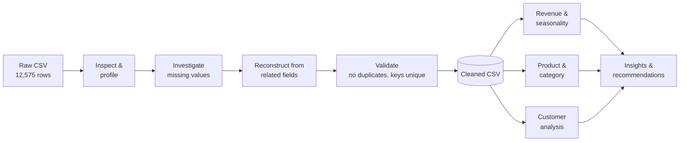

<div align="center">

# 🛒 Retail Store Sales Analysis

### Python data cleaning, validation & exploratory analysis of 3 years of retail sales


*From a messy 12,575-row export to an analysis-ready dataset, then to clear answers about revenue, seasonality, products and customers.*

</div>

---

## 📌 TL;DR

| | |
|---|---|
| **Business** | A retail store selling 200 products across 8 categories to 25 customers, online and in-store |
| **Scope** | 12,362 transactions, Jan 2022 – Dec 2024 (the 18 days of Jan 2025 were excluded, see [why](#-dataset)) |
| **Revenue** | **$1.60M** in total: $535.6K → $513.1K (−4.2%) → $548.8K (+7.0%) |
| **Biggest finding** | Revenue is **flat, not growing** (+2.5% over two years). The customer base never changes (25), average order value never moves (~$129), so every swing in revenue comes from how often the same customers order |
| **Seasonality** | January is the top revenue month every year, and February drops 16–22% straight after |
| **Product insight** | The most-sold item (`Item_2_BEV`, 706.8 units) earned **5.8× less** than `Item_25_FUR` (647.8 units) because of a $6.50 vs $41.00 price point |
| **Data quality** | Recovered **99.65%** of missing values by reconstructing them from related fields, instead of blanket imputation |

---

## 📑 Table of Contents

1. [Project Overview](#-project-overview)
2. [Dataset](#-dataset)
3. [Tools & Technologies](#-tools--technologies)
4. [Workflow](#-workflow)
5. [Data Cleaning & Validation](#-data-cleaning--validation)
6. [Analysis & Findings](#-analysis--findings)
7. [Business Questions Answered](#-business-questions-answered)
8. [Recommendations](#-recommendations)
9. [Limitations](#-limitations--honest-caveats)
10. [Visualizations](#-visualizations)
11. [How to Run](#-how-to-run)
12. [Repository Structure](#-repository-structure)
13. [Skills Demonstrated](#-skills-demonstrated)
14. [Future Improvements](#-future-improvements)
15. [About the Analyst](#-about-the-analyst)

---

## 🎯 Project Overview

Real-world data is rarely analysis-ready. This project takes a raw retail sales export with missing prices, quantities, totals and product names, and treats cleaning as part of the analysis rather than a chore before it.

**The guiding principle: investigate the data before interpreting it.**

The work happens in two notebooks:

1. **Cleaning & validation**: profile the data, work out *which fields can reconstruct which*, rebuild missing values from first principles, and only then fall back to averages.
2. **Exploratory analysis**: measure revenue, seasonality, product and category performance, and customer behaviour, and separate *what the data shows* from *what it can't explain*.

---

## 🗂 Dataset

| Property | Detail |
|---|---|
| **File** | `retail_store_sales.csv` (raw) → `python cleaned.csv` (cleaned) |
| **Size** | 12,575 rows × 10 columns |
| **Period** | 2022-01-01 → 2025-01-18 |
| **Grain** | One row = one transaction (every `Transaction ID` is unique) |
| **Analysis window** | **2022–2024** (12,362 transactions) |

**Why 2025 was excluded:** it holds only 213 transactions ($26,466) from the first 18 days of January. Comparing a partial month to full years would make 2025 look like a collapse when it is just incomplete.

<details>
<summary><b>Data dictionary</b></summary>

| Column | Description | Notes |
|---|---|---|
| `Transaction ID` | Unique transaction key | `TXN_#######`, 12,575 unique values |
| `Customer ID` | Customer identifier | `CUST_01` … `CUST_25` |
| `Category` | Product category | 8 categories |
| `Item` | Product identifier | 200 products (25 per category), e.g. `Item_25_FUR` |
| `Price Per Unit` | Unit price ($) | $5.00 – $41.00 in $1.50 steps |
| `Quantity` | Units purchased | 1 – 10 per transaction |
| `Total Spent` | Transaction value ($) | $5 – $410 (= price × quantity) |
| `Payment Method` | How the customer paid | Cash, Credit Card, Digital Wallet |
| `Location` | Sales channel | Online, In-store |
| `Transaction Date` | Date of sale | Parsed to `datetime64` |

</details>

---

## 🛠 Tools & Technologies

| Tool | Used for |
|---|---|
| **Python** | End-to-end cleaning, transformation and analysis |
| **Pandas** | Data manipulation, `groupby`/`pivot_table` aggregation, imputation logic |
| **NumPy** | Numerical operations and array handling |
| **Matplotlib** | Charts (trends and comparisons) |
| **Seaborn** | Plot styling and statistical visualization |
| **Jupyter Notebook** | Interactive, documented analysis |
| **Git / GitHub** | Version control and project documentation |

---

## 🔄 Workflow



---

## 🧹 Data Cleaning & Validation

*Notebook: [`EDA data cleaning.ipynb`](EDA%20data%20cleaning.ipynb)*

### What was wrong

| Column | Missing (before) | Missing (after) |
|---|---:|---:|
| `Item` | 1,213 (9.6%) | **0** |
| `Price Per Unit` | 609 (4.8%) | **0** |
| `Quantity` | 604 (4.8%) | 44 (0.35%) |
| `Total Spent` | 604 (4.8%) | 44 (0.35%) |

`Quantity` and `Total Spent` were missing **together** in the same 604 rows, which means one cannot be derived from the other. That is what made the fallback step necessary.

### Strategy: reconstruct first, estimate last

Rather than filling every blank with a mean, each gap was filled with the most reliable evidence available, in this order:

| # | Step | Logic |
|---|---|---|
| 1 | **Price Per Unit** | `Total Spent ÷ Quantity` |
| 2 | **Item name** | Within a category, every price maps to exactly **one** item (verified, see below), so `(Category, Price)` is a lookup key |
| 3 | **Quantity** | `Total Spent ÷ Price Per Unit` |
| 4 | **Total Spent** | `Quantity × Price Per Unit` |
| 5 | **Fallback** | Customer × Item average, **only** where history existed (560 of the 604 remaining gaps) |
| 6 | **Left blank** | 44 rows with no reliable basis, kept as `NaN` rather than invented |

> Leaving 44 rows empty was deliberate. Imputing a value without a defensible basis would put artificial patterns into the analysis.

<details>
<summary><b>Core cleaning code</b></summary>

```python
# 1. Rebuild unit price from the other two fields
df['Price Per Unit'] = df['Price Per Unit'].fillna(df['Total Spent'] / df['Quantity'])

# 2. Recover missing product names via a (Category, Price) -> Item lookup table
price_list = (df[df['Item'].notna()]
              .groupby(['Category', 'Price Per Unit'])['Item'].unique().reset_index())
df = df.merge(price_list, how='left', on=['Category', 'Price Per Unit'],
              suffixes=('', '_from_price_list'))
df['Item'] = df['Item'].fillna(df['Item_from_price_list'])
df = df.drop(columns=['Item_from_price_list'])

# 3-4. Reconstruct quantity and total from the identity  total = price x quantity
df['Quantity']    = df['Quantity'].fillna(df['Total Spent'] / df['Price Per Unit'])
df['Total Spent'] = df['Total Spent'].fillna(df['Quantity'] * df['Price Per Unit'])

# 5. Flatten single-element arrays produced by the merge (Customer ID, Item)
flatten = lambda x: x.item() if isinstance(x, np.ndarray) and x.size == 1 else x
df['Customer ID'] = df['Customer ID'].apply(flatten)
df['Item']        = df['Item'].apply(flatten)

# 6. Last resort: customer x item average, only where history exists
for col, nd in [('Quantity', 1), ('Total Spent', 2)]:
    df[col] = df[col].fillna(df.groupby(['Customer ID', 'Item'])[col].transform('mean')).round(nd)
```

</details>

### Validation checks

| Check | Result |
|---|---|
| Duplicate rows | **0** |
| `Transaction ID` uniqueness | 12,575 / 12,575 unique |
| Category + price → item mapping | **One-to-one** (no two items in a category share a price), which is what makes step 2 safe |
| Date parsing | `Transaction Date` converted to `datetime64` |
| Structural issues | Array-wrapped values in `Customer ID` / `Item` flattened to scalars |

---

## 📊 Analysis & Findings

*Notebook: [`Exploratory Data analysis.ipynb`](Exploratory%20Data%20analysis.ipynb)*

### 1. Revenue: stable, not growing

| Year | Revenue | YoY | Orders | Units sold | Customers | AOV |
|---|---:|---:|---:|---:|---:|---:|
| 2022 | $535,569.29 | n/a | 4,134 | 22,950.1 | 25 | $129.55 |
| 2023 | $513,065.05 | **−4.20%** | 3,987 | 21,996.1 | 25 | $128.68 |
| 2024 | $548,830.67 | **+6.97%** | 4,241 | 23,251.6 | 25 | $129.41 |

- **Volume, not price, moves revenue.** The 2023 dip is orders −3.6% with AOV −0.7%; the 2024 rebound is orders +6.4% with AOV +0.6%.
- With a fixed 25 customers, that means orders per customer swung **165 → 160 → 170**.
- Net result over two years: **+2.5% (≈1.2% a year)**. Recovery, not growth.

> *Units sold contain decimals because ~4.5% of rows carry customer-average imputed quantities. See [Limitations](#-limitations--honest-caveats).*

### 2. Seasonality: a repeating January peak


| Year | Dec (prior yr) | **Jan** | Feb | Jan → Feb | Jan orders | Feb orders |
|---|---:|---:|---:|---:|---:|---:|
| 2022 | n/a | **$55,748.76** | $45,840.50 | −17.8% | 389 | 329 |
| 2023 | $40,983.07 | **$49,100.34** | $41,100.03 | −16.3% | 371 | 312 |
| 2024 | $44,950.74 | **$50,588.03** | $39,504.83 | −21.9% | 383 | 319 |

- **January is the highest-revenue month in all three years**, and Feb falls **16–22%** straight after.
- December has risen every year ($40,983 → $44,951 → $50,228), and the December→January step-up is +19.8% (2022→23) and +12.5% (2023→24).
- *Precision note:* January also has the most orders in 2022 and 2024, but in 2023 July edged it (374 vs 371).
- Plausible drivers (holiday buying, year-end promotions, new-year behaviour) **cannot be confirmed** because the dataset has no promotion or calendar data, and three cycles is a short history.

### 3. Categories: balanced mix, no dominant line

| Category | Revenue | Share | Orders | Units |
|---|---:|---:|---:|---:|
| 🥩 Butchers | **$212,255.26** | 13.29% | 1,543 | 8,399.3 |
| 🔌 Electric household essentials | $210,848.37 | 13.20% | 1,566 | 8,575.9 |
| 🥤 Beverages | $201,647.36 | 12.62% | 1,541 | 8,554.9 |
| 🛋 Furniture | $200,561.18 | 12.55% | **1,567** | 8,657.5 |
| 🍞 Food | $200,044.78 | 12.52% | 1,551 | **8,668.4** |
| 💻 Computers & electric accessories | $195,709.38 | 12.25% | 1,526 | 8,512.6 |
| 🧁 Patisserie | $190,167.62 | 11.90% | 1,507 | 8,257.2 |
| 🥛 Milk Products | $186,231.06 | 11.66% | 1,561 | 8,572.0 |

The category with the most **revenue** (Butchers) is not the one with the most **units** (Food) or **orders** (Furniture). Revenue, volume and order count have to be read together.

### 4. Category trends: where the movement is

| Category | 2022 | 2023 | 2024 | 2023 vs 22 | 2024 vs 23 |
|---|---:|---:|---:|---:|---:|
| Butchers | $81,623.95 | $62,342.27 | $68,289.04 | 🔻 −23.6% | 🔺 +9.5% |
| Electric household essentials | $74,103.91 | $67,898.85 | $68,845.61 | 🔻 −8.4% | 🔺 +1.4% |
| Beverages | $66,529.88 | $57,370.69 | $77,746.79 | 🔻 −13.8% | 🔺 **+35.5%** |
| Furniture | $64,407.79 | $65,270.68 | $70,882.71 | 🔺 +1.3% | 🔺 +8.6% |
| Food | $60,838.00 | $70,438.99 | $68,767.79 | 🔺 +15.8% | 🔻 −2.4% |
| Computers & electric acc. | $60,654.66 | $65,343.23 | $69,711.49 | 🔺 +7.7% | 🔺 +6.7% |
| Patisserie | $66,838.68 | $58,983.14 | $64,345.80 | 🔻 −11.8% | 🔺 +9.1% |
| Milk Products | $60,572.42 | $65,417.20 | $60,241.44 | 🔺 +8.0% | 🔻 −7.9% |

- **Only Furniture and Computers & electric accessories grew in both years.**
- **Butchers fell from #1 (2022) to #6 (2024).** It still leads on three-year revenue because of a strong 2022.
- **Beverages jumped 35.5% in 2024** to become the top category. Worth understanding what caused it.

### 5. Products: price drives revenue

| Top 5 by revenue | Category | Revenue | Units | Unit price |
|---|---|---:|---:|---:|
| `Item_25_FUR` | Furniture | $26,561.17 | 647.8 | $41.00 |
| `Item_25_EHE` | Electric household essentials | $26,400.57 | 643.9 | $41.00 |
| `Item_25_BUT` | Butchers | $23,265.16 | 567.5 | $41.00 |
| `Item_24_FUR` | Furniture | $23,071.96 | 584.0 | $39.50 |
| `Item_25_FOOD` | Food | $22,276.67 | 543.3 | $41.00 |

| Top 5 by units | Category | Units | Revenue | Unit price |
|---|---|---:|---:|---:|
| `Item_2_BEV` | Beverages | **706.8** | $4,594.58 | $6.50 |
| `Item_16_MILK` | Milk Products | 689.0 | $18,947.50 | $27.50 |
| `Item_19_CEA` | Computers & electric acc. | 650.8 | $20,824.00 | $32.00 |
| `Item_19_MILK` | Milk Products | 650.6 | $20,819.91 | $32.00 |
| `Item_25_FUR` | Furniture | 647.8 | $26,561.17 | $41.00 |

**The headline contrast:** `Item_2_BEV` sold the most units (706.8) but earned only $4,594.58. `Item_25_FUR` sold fewer (647.8) yet earned **$26,561.17**, or 5.8× more, purely because of price ($41.00 vs $6.50).

**Weakest items.** The five lowest earners are all priced $5–$11 *and* see few orders (5–29), so low price and low demand compound. `Item_3_EHE` is the weakest overall (**$224**, 28 units, 5 orders) and made **$0 in 2022**. Whether that was a late launch, a stock-out or no demand can't be determined from this data.

> 💡 **Data pattern:** the item number encodes the price tier (`price = $5 + $1.50 × (n − 1)`), so `Item_25_*` is always $41.00 and `Item_1_*` always $5.00.

### 6. Customers: evenly spread, fully static

| Metric | Result |
|---|---|
| Customers | **25 in every year**, none added or lost |
| Top customer | `CUST_24`: $70,791.30 (4.4% of revenue) |
| Next four | `CUST_08` $69,760.65 · `CUST_05` $69,486.36 · `CUST_13` $66,957.29 · `CUST_16` $66,674.94 |
| Lowest customer | `CUST_25`: $58,856.46 |
| Top 5 customers | 21.5% of revenue (an even split would be 20%) |
| Top ÷ bottom | only 1.2× |
| Orders per customer | 456 (`CUST_03`) → 540 (`CUST_05`) over three years |
| AOV per customer | $122.97 → $138.13 |

**No concentration risk.** No single customer is a dependency, and the whole base behaves similarly.

**Transaction-value distribution** (all 2022–24 transactions): mean $129.66 vs median $108.50, **skewness +0.83** and **excess kurtosis −0.10**. Positive skew means a right-leaning distribution, with a minority of high-value transactions pulling the mean above the median. Kurtosis near zero means tail weight close to a normal curve.

**First-purchase dates.** 24 of 25 customers first appear within the first 8 days of January 2022, and the last on Jan 17. At roughly 165 orders per customer per year (one every ~2 days), early first appearances are expected *whatever* the history, so this alone can't tell us whether these are new or pre-existing customers. What it does show is that **no new customer ever appears after January 2022**.

---

## ❓ Business Questions Answered

| # | Question | Answer |
|---|---|---|
| 1 | How has revenue changed year to year? | −4.20% in 2023, +6.97% in 2024; +2.5% net vs 2022 |
| 2 | How have orders and AOV changed? | Orders 4,134 → 3,987 → 4,241; AOV flat at ~$129 |
| 3 | Are there seasonal patterns? | Yes: January peak every year, then a 16–22% February drop |
| 4 | Which categories earn the most? | Butchers ($212.3K) and Electric household essentials ($210.8K) |
| 5 | Which products perform best? | By revenue `Item_25_FUR`; by units `Item_2_BEV` |
| 6 | Why can high volume earn less revenue? | Unit price: $6.50 vs $41.00 outweighs a 9% volume gap |
| 7 | Are revenue patterns consistent across customers? | Yes, the top customer is only 1.2× the lowest |
| 8 | What needs further investigation? | `Item_3_EHE` ($0 in 2022), Butchers' slide, Beverages' 2024 jump |
| 9 | Any concentration or retention signal? | No concentration; the base is static at 25, so retention can't be measured |
| 10 | What extra data is needed? | Stock, costs, promotions, pre-2022 history, a full 2025 |

---

## 💡 Recommendations

Based strictly on the patterns above, in priority order:

1. **Grow the customer base.** AOV and customer count are both flat, so growth requires new customers or more orders from existing ones. A 25-customer base with a ~1.2% annual trend won't scale on its own.
2. **Plan around the Dec–Jan peak and February trough.** Align stock and staffing to the peak, and test a targeted February promotion to soften a recurring 16–22% drop.
3. **Look at price-tier mix.** High-priced items generate disproportionate revenue. Test bundling or upsell on high-volume, low-price products like `Item_2_BEV`.
4. **Audit the movers.** Find out why Butchers slipped to #6, why Beverages surged 35.5%, and why Milk Products fell 7.9% in 2024.
5. **Review the weakest SKUs.** Items like `Item_3_EHE` need cost and stock data before deciding to promote or retire them.
6. **Close the data gaps.** Add inventory, product cost, promotions/discounts and full historical records, which would move the analysis from *what happened* to *why*.

---

## ⚠️ Limitations & Honest Caveats

- **Imputed values.** ~4.5% of rows (560) use a customer-and-item average for `Quantity`/`Total Spent`. Each average rests on only a few prior transactions, so totals carry some uncertainty. This also explains the fractional unit counts.
- **No profitability.** There are no cost data, so only revenue can be analyzed, not margin.
- **Only 25 customers.** Customer-level conclusions describe this dataset and shouldn't be generalized.
- **No history before 2022.** New-vs-returning customers, churn and lifetime value can't be measured.
- **No inventory or marketing data.** Stock-outs, launches and promotions can't be ruled in or out as causes.
- **Short time series.** "Seasonality" rests on three annual cycles: strong, consistent, but not conclusive.
- **Very uniform data.** The even customer activity, regular price grid and balanced categories are typical of simulated or practice datasets.
- **Unused columns.** `Payment Method` and `Location` (online vs in-store) were not analyzed.

---


---

## 🚀 How to Run

**Prerequisites:** Python 3.10+ and Jupyter.

```bash
# 1. Clone
git clone https://github.com/<your-username>/Retail-Store-Sales-Analysis.git
cd Retail-Store-Sales-Analysis

# 2. Install dependencies
pip install pandas numpy matplotlib seaborn jupyter

# 3. Launch
jupyter notebook
```

Then run the notebooks **in this order**:

1. `EDA data cleaning.ipynb`: reads the raw CSV and writes `python cleaned.csv`
2. `Exploratory Data analysis.ipynb`: reads `python cleaned.csv`

> ℹ️ The notebooks load files from a local Windows path. Update the `pd.read_csv(...)` and `to_csv(...)` paths to match your machine.

---

## 📂 Repository Structure

```
Retail-Store-Sales-Analysis/
│
├── retail_store_sales.csv              # Raw input data
├── EDA data cleaning.ipynb             # Inspection, cleaning & validation
├── python cleaned.csv                  # Analysis-ready dataset (output of notebook 1)
├── Exploratory Data analysis.ipynb     # Revenue, seasonality, product & customer analysis
├── images/                             # Exported charts used in this README
└── README.md
```

---

## 🧠 Skills Demonstrated

| Area | Evidence |
|---|---|
| **Data cleaning** | Conditional imputation from field relationships, structural fixes, type conversion, duplicate and key validation |
| **Exploratory analysis** | Descriptive statistics, skew/kurtosis, trend, YoY and seasonality analysis |
| **Business analysis** | KPI design (revenue, AOV, units, orders), price-vs-volume decomposition, concentration analysis |
| **Analytical judgement** | Excluding an incomplete year, leaving ungroundable values blank, separating observed patterns from unprovable causes |
| **Python stack** | `groupby`, `pivot_table`, `merge`, `fillna`, `pct_change`, Matplotlib/Seaborn |
| **Communication** | Findings paired with caveats, and recommendations tied to evidence |

---

## 🔭 Future Improvements

- [ ] Sensitivity check: re-run key results **excluding imputed rows** to quantify their impact
- [ ] Analyze `Payment Method` and `Location` (online vs in-store) performance
- [ ] RFM segmentation and customer lifetime value
- [ ] Cohort/retention analysis (needs pre-2022 history)
- [ ] Price-tier and price-elasticity analysis
- [ ] Add inventory, cost and marketing data for margin and stock-out analysis
- [ ] Hypothesis tests on the Jan/Feb seasonal gap
- [ ] Interactive Tableau / Power BI dashboard
- [ ] SQL version of the analysis, and an automated cleaning pipeline
- [ ] Forecasting model (once a longer history is available)

---

## 👨‍💻 About the Analyst

**Sunday Abiodun Ogboi**: Data Analyst | Python · SQL · Excel · Power BI · Tableau

I build practical analytics projects that show the *whole* workflow, not just the charts:

`Raw data → Cleaning → Validation → Analysis → Insights → Business questions`

📫 **Let's connect:** [LinkedIn](https://www.linkedin.com/in/your-handle) · [GitHub](https://github.com/your-username) · [Email](mailto:your.email@example.com)

---

<div align="center">

**The most important outcome isn't the charts. It's the process used to decide what the data can and can't tell us.**

⭐ If you found this useful, consider starring the repo.

</div>
